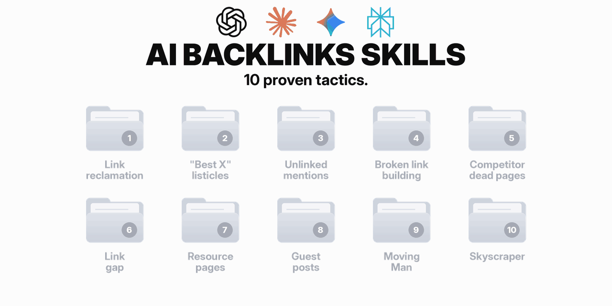

# Link building skill for AI agents

**Give your AI agent your site. It finds the link opportunities, checks every link, finds a real contact and drafts the emails. You hit send.**



[](LICENSE)
[](#quickstart)
[](#quickstart)

Ten link building tactics, each a playbook with a clear pass or fail at every step, plus a working toolkit: dead link checks, expired domains, Wayback history, contact scanning and one tracker CSV.

Built by [James Oliver](https://oliver.com/?utm_source=github&utm_medium=readme&utm_campaign=linkbuilding-skill&utm_content=author). The full write-up and a real run: [I turned my link building into a free Claude Code skill](https://oliver.com/blog/free-link-building-skill?utm_source=github&utm_medium=readme&utm_campaign=linkbuilding-skill&utm_content=post).

## Get more skills and updates

This repo is free and always will be. I'm adding new skills regularly.

**[Join the email list](https://olivercom.substack.com/subscribe?utm_source=github&utm_medium=readme&utm_campaign=linkbuilding-skill&utm_content=email-section)** to get every new skill, template and update in your inbox. No spam, unsubscribe anytime.

## Want a hosted version instead?

Don't want to run anything yourself? Everything here is also on **[Answer Socrates](https://answersocrates.com/?utm_source=github&utm_medium=readme&utm_campaign=linkbuilding-skill&utm_content=hosted-section)**, with no setup and many more features, including keyword research, trends, rising topics, YouTube keywords and clustering.

**[Try it on Answer Socrates](https://answersocrates.com/?utm_source=github&utm_medium=readme&utm_campaign=linkbuilding-skill&utm_content=hosted-button)**

## Quickstart

**1. Install** (pick one):

```bash
# Any agent that supports skills (Claude Code, Codex, Cursor and others)
npx skills add JamesOliverSEO/linkbuilding-skill

# Or clone it straight into Claude Code's skills folder
git clone https://github.com/JamesOliverSEO/linkbuilding-skill ~/.claude/skills/linkbuilding
```

> [!TIP]
> If you run `npx skills add` from inside an agent session, pass the agent explicitly, for example `npx skills add JamesOliverSEO/linkbuilding-skill -a claude-code`.

**2. Ask in plain English:**

> Build links to mysite.com. It's a [niche] site. What should I do first?

That's it. It asks for anything it needs, picks a tactic, and walks you through it one step at a time. More starter prompts are in [prompts.md](prompts.md).

**3. Optional: connect DataForSEO** for the backlink lookups (see below).

## The ten tactics

| # | Tactic | Start here when |
|---|---|---|
| 1 | [Link reclamation](tactics/link-reclamation.md) | your site is older, moved URLs, or lost links |
| 2 | ["Best X" listicles](tactics/listicle-inclusion.md) | you sell a product |
| 3 | [Unlinked mentions](tactics/unlinked-mentions.md) | people already talk about your brand |
| 4 | [Broken link building](tactics/broken-link-building.md) | your niche has old resource lists and guides |
| 5 | [Competitor dead pages](tactics/competitor-dead-pages.md) | competitors have pruned or moved old content |
| 6 | [Link gap](tactics/link-gap.md) | you have clear competitors with more links |
| 7 | [Resource pages](tactics/resource-pages.md) | you have a genuinely useful guide or tool |
| 8 | [Guest posts](tactics/guest-posts.md) | you can write expert articles |
| 9 | [Moving Man](tactics/moving-man.md) | a tool or brand in your niche rebranded or shut down |
| 10 | [Skyscraper](tactics/skyscraper.md) | a competitor piece earns lots of links and you can beat it |

## What works free, and what needs DataForSEO

The toolkit is one Python file with no installs. Most of it is free. The backlink lookups use the [DataForSEO](https://dataforseo.com/?aff=62023770-bfef-4587-b9a7-a054b5b8d88f) Backlinks API, which is pay as you go. The skill always shows an estimate and waits for a yes before spending anything.

| Tactic | Without DataForSEO | Rough cost with it |
|---|---|---|
| Unlinked mentions | Works fully | $0 |
| Resource pages | Works fully | $0 |
| "Best X" listicles | Works, finds lists by search | ~$0.04 per competitor |
| Broken link building | Works, but cannot rank dead links by value | ~$0.03 to $0.05 a batch |
| Guest posts | Works, skips the site strength check | ~$0.03 for the whole list |
| Link reclamation | Needs it | ~$0.10 per site |
| Competitor dead pages | Needs it | ~$0.03 per competitor, plus ~$0.03 per page |
| Link gap | Needs it | ~$0.15 for three competitors |
| Moving Man | Needs it to find the linking sites | ~$0.03 per closed brand |
| Skyscraper | Needs it | ~$0.06 per competitor |

Costs measured in October 2026: about 2.4 US cents per call plus a tiny amount per row. Running all ten for one site costs well under a dollar.

To connect it, [create a DataForSEO account](https://dataforseo.com/?aff=62023770-bfef-4587-b9a7-a054b5b8d88f), then set your API login:

```bash
export DATAFORSEO_LOGIN="your-login"
export DATAFORSEO_PASSWORD="your-api-password"
```

Or put those two lines (without `export`) in a `.env` file and point to it with `DATAFORSEO_ENV_FILE=/path/to/.env`. Never commit that file.

## What is inside

```
linkbuilding-skill/
  SKILL.md               the brain: picks the tactic, sets the rules
  prompts.md             starter prompts for every tactic
  footprints.md          search strings that find prospects
  tracker-template.csv   the one spreadsheet you keep
  tactics/               one playbook per tactic
  scripts/blb.py         the toolkit: 13 commands, Python 3, no installs
```

## House rules

- It never sends email. It drafts, you send from your own inbox.
- No guessed email addresses and no paid email finders.
- It never pays for links. A site asking for a fee gets flagged for you.
- One follow-up per prospect, then it stops.
- One conversation per site at a time, tracked in one CSV.

## Questions and ideas

Found a bug, or a tactic that should work differently? [Open an issue](https://github.com/JamesOliverSEO/linkbuilding-skill/issues).

## Licence

MIT. See [LICENSE](LICENSE).

---

⭐ Star the repo if it helped · [Join the list](https://olivercom.substack.com/subscribe?utm_source=github&utm_medium=readme_footer&utm_campaign=linkbuilding-skill) · [Hosted version](https://answersocrates.com/?utm_source=github&utm_medium=readme_footer&utm_campaign=linkbuilding-skill)
